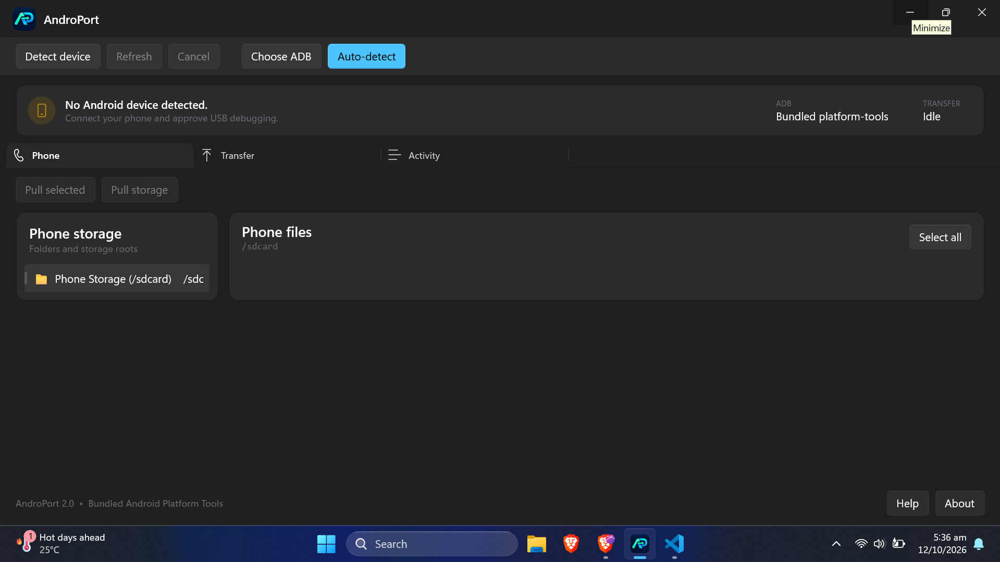
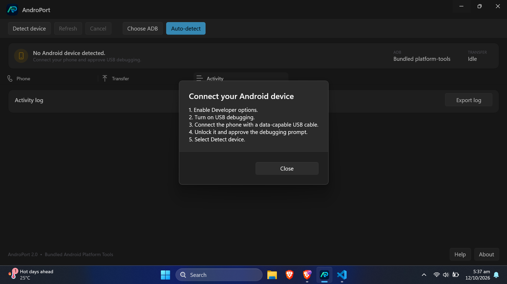
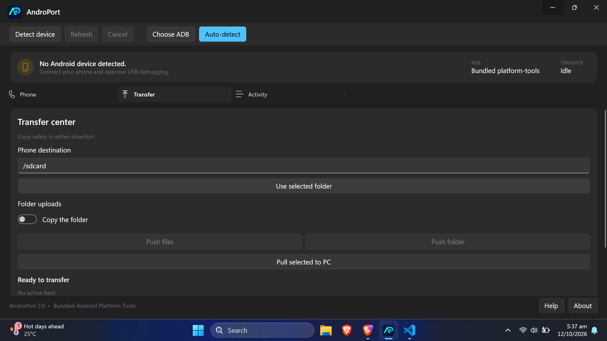
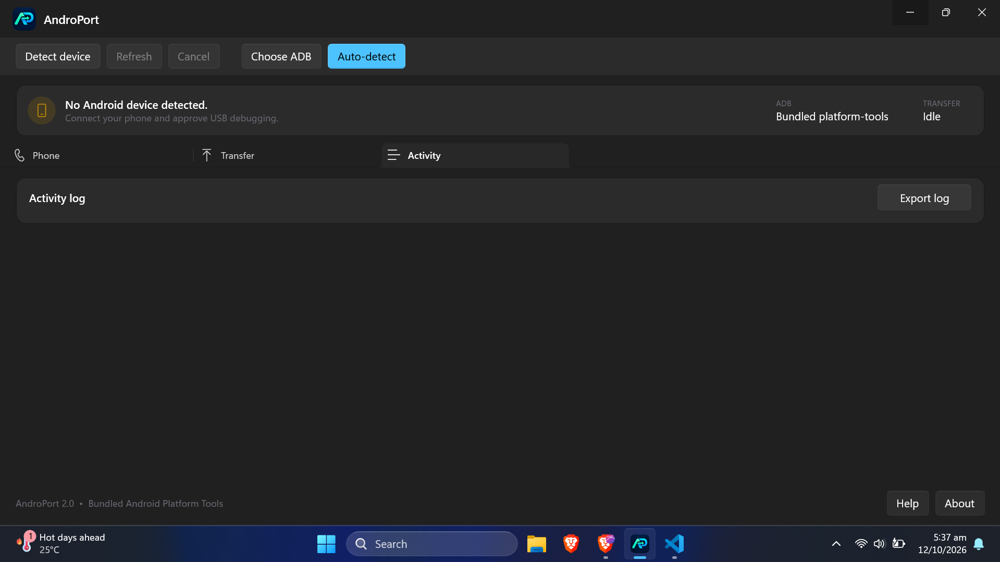

# AndroPort

  
   
  <strong>Fast file transfer between Windows and Android that bypasses slow Windows MTP.</strong>
   
  
  
  
  
  
  
   
  <a href="https://github.com/J3M09/AndroPort/releases"><strong>Download AndroPort-v2.0.0-win-x64.msi</strong></a>

AndroPort is a modern WinUI 3 desktop app for copying folders and files between Windows and Android with the bundled Android Platform Tools.

## Contents

- [Tech Stack](#tech-stack)
- [Why AndroPort?](#why-androport)
- [Features](#features)
- [Screenshots / visual tour](#screenshots--visual-tour)
- [Requirements](#requirements)
- [Install](#install-msi)
- [How to use](#how-to-use--full-speed-no-mtp)
- [Button reference](#button-reference)
- [ADB setup](#adb-setup)
- [Troubleshooting](#troubleshooting)

## Tech Stack

### Languages

### Desktop & Frameworks

### Tools & Platform

---

## Why AndroPort?

Windows Explorer MTP transfer is slow, stalls on large folders, and often fails on many small files.

AndroPort uses ADB (`adb push` / `adb pull`) over USB debugging instead of MTP, so you get full USB bulk speed:

- Browse internal phone storage and removable cards from Windows
- Pull files/folders or a whole storage root from Android to PC
- Push multiple PC files or a whole folder to Android
- Live progress, byte count, speed, elapsed time, and ETA
- Cancel safely, skip recoverable per-item errors, export activity log
- No separate ADB install — Platform Tools 37.0.0 is embedded in the app

## Features

- Phone storage browser with expandable roots and multi-select
- `Pull selected`, `Pull storage`, `Push files`, `Push folder`, `Pull selected to PC`
- `Phone destination` textbox + `Use selected folder` shortcut
- `Folder uploads` toggle: copy the folder vs. copy only its contents
- Automatic detection of connected / unauthorized / offline / missing devices
- `Choose ADB` for a custom `adb.exe`, `Auto-detect` to return to bundled tools
- Native Windows light/dark theme + Mica backdrop
- Timestamped activity log with `Export log`

Tech: WinUI 3 + Windows App SDK 2.5.1, .NET 8, self-contained unpackaged deployment. No .NET or App SDK runtime to install separately.

## Screenshots / visual tour

| File | Shows |
|------|-------|
| `01-main-phone-tab.png` | Main window, Phone tab |
| `03-help-connect.png` | Help / connect checklist |
| `04-transfer-center.png` | Transfer tab |
| `05-activity-log.png` | Activity tab |

### 1. Main window — Phone tab

- Top bar: `Detect device`, `Refresh`, `Cancel`, `Choose ADB`, `Auto-detect`
- Status card: `No Android device detected. Connect your phone and approve USB debugging.` / `ADB: Bundled platform-tools` / `TRANSFER: Idle`
- Tabs: `Phone` | `Transfer` | `Activity`
- Phone tab: `Pull selected`, `Pull storage`
- Left: `Phone storage — Folders and storage roots`, e.g. `Phone Storage (/sdcard)`
- Right: `Phone files — /sdcard` + `Select all`
- Footer: `AndroPort 2.0 • Bundled Android Platform Tools` + `Help` / `About`

### 2. About dialog

`About` (footer, next to `Help`) shows:

> AndroPort 2.0 — AndroPort is a modern WinUI 3 desktop app for copying folders and files between Windows and Android with the bundled Android Platform Tools.

### 3. Help — Connect your Android device

`Help` shows the connect checklist:

1. Enable Developer options.
2. Turn on USB debugging.
3. Connect the phone with a data-capable USB cable.
4. Unlock it and approve the debugging prompt.
5. Select Detect device.

### 4. Transfer center

`Transfer` tab — `Transfer center — Copy safely in either direction`:

- `Phone destination` (default `/sdcard`), `Use selected folder`
- `Folder uploads` toggle (`Copy the folder` / `Copy only its contents`)
- `Push files`, `Push folder`, `Pull selected to PC`
- `Ready to transfer — No active item`

### 5. Activity log

`Activity` tab — `Activity log` + `Export log` for diagnostics.

---

## Requirements

- Windows 10 version 1809 (build 17763) or newer, x64
- Android phone/tablet with USB debugging enabled
- Data-capable USB cable (charge-only cables will not work)

## Install (MSI)

1. On GitHub open this repo: `https://github.com/J3M09/AndroPort`
2. Open `Releases` → download `AndroPort-v2.0.0-win-x64.msi`
3. Double-click the `.msi` and follow the wizard (per-user install to `%LOCALAPPDATA%\AndroPort`, no UAC prompt, Start Menu shortcut `AndroPort`)
4. Launch `AndroPort` from Start Menu

Unsigned build note: SmartScreen may warn until the app establishes reputation or is signed with a trusted certificate.

## Navigating this repository on GitHub

- `Code` tab — this README, `docs/screenshots/`, installer notes
- `Releases` — download the `.msi` installer
- `Issues` — report bugs (attach exported log + screenshots)
- `Commits / Activity` — what changed

## How to use — full speed, no MTP

### 1. Enable USB debugging on the phone

1. `Settings > About phone > Build number` — tap 7 times until `You are now a developer`
2. `Settings > System > Developer options` (Samsung: `Settings > Developer options`)
3. Turn on `USB debugging` → `OK`

### 2. Connect and approve

1. Connect with a data-capable cable
2. Unlock the phone
3. Approve `Allow USB debugging?` (tick `Always allow from this computer` → `Allow`)
4. No prompt? Unplug/replug, try another cable/port, toggle USB debugging off/on

### 3. Detect in AndroPort

1. Open AndroPort — top bar should say `ADB: Bundled platform-tools`, `Auto-detect` on
2. Click `Detect device`
3. Status card switches from `No Android device detected` to your device
4. Still missing? Open `Help`, walk the 5 steps, then `Refresh`. Check `Activity > Export log` for `unauthorized` / `offline` hints

### 4. Browse phone files

1. `Phone` tab → left `Phone storage` → select `Phone Storage (/sdcard)`
2. Right `Phone files` lists `/sdcard` — double-click to enter folders
3. Tick items or use `Select all`

### 5. Pull — Phone → PC

- Phone tab: select → `Pull selected` → pick PC folder; or `Pull storage` for a full `/sdcard` backup
- Or Transfer tab: `Pull selected to PC`

### 6. Push — PC → Phone

1. `Transfer` tab → set `Phone destination`, e.g. `/sdcard`, `/sdcard/Download`, `/sdcard/DCIM/Camera`
2. Tip: `Use selected folder` fills it from your current Phone-tab folder
3. `Folder uploads` toggle:
   - `Copy the folder` = `MyPics` → `/sdcard/Download/MyPics`
   - `Copy only its contents` = contents of `MyPics` → directly into destination
4. `Push files` (one or more files) or `Push folder`
5. Watch live progress/speed/ETA. `Cancel` aborts safely

### 7. Check the log

`Activity` tab → review commands/errors → `Export log` when asking for help.

## Button reference

| Button | Where | Does |
|--------|-------|------|
| `Detect device` | Top bar | `adb devices`, authorize + list device |
| `Refresh` | Top bar | Re-list current folder |
| `Cancel` | Top bar | Abort active transfer |
| `Choose ADB` | Top bar | Use custom `adb.exe` |
| `Auto-detect` | Top bar | Back to bundled platform-tools |
| `Pull selected` | Phone | Phone files → PC |
| `Pull storage` | Phone | Whole `/sdcard` → PC |
| `Select all` | Phone files | Select all in folder |
| `Use selected folder` | Transfer | Fill destination from Phone tab |
| `Push files` | Transfer | PC files → phone |
| `Push folder` | Transfer | PC folder → phone |
| `Pull selected to PC` | Transfer | Same as `Pull selected` |
| `Export log` | Activity | Save timestamped log |
| `Help` | Footer | Connect checklist |
| `About` | Footer | Version + description |

## ADB setup

Default is correct for most users: `ADB: Bundled platform-tools` with `Auto-detect` on.

- Platform Tools 37.0.0 is embedded in the exe and extracted on first run under `%LOCALAPPDATA%\AdbFileTransferApp\EmbeddedPlatformTools\`
- Use `Choose ADB` only if you need a specific SDK version, then `Auto-detect` to revert
- Manual check: `adb devices` should show `<serial>  device`; `unauthorized` means approve the phone prompt and `Detect device` again

## Data and privacy

Local-only. The app launches the bundled `adb.exe` to talk directly to the device. No file uploads or telemetry.

- Settings: `%LOCALAPPDATA%\AdbFileTransferApp\settings.json`
- Extracted tools: `%LOCALAPPDATA%\AdbFileTransferApp\EmbeddedPlatformTools\`
- Install folder (MSI): `%LOCALAPPDATA%\AndroPort\` (`AdbFileTransferApp.exe`)

## Troubleshooting

**No device detected**

- Data cable only, try another cable/port (rear motherboard USB, no hub for big transfers)
- USB mode that permits data, unlock phone, approve prompt
- `Detect device` → `Refresh`; close other ADB tools

**Unauthorized / offline**

- Unlock + approve; `Developer options > Revoke USB debugging authorizations` → reconnect
- Replug, `Detect device` again, check Activity log

**MTP works but ADB is empty**

- Normal: MTP ≠ ADB. ADB needs USB debugging ON.

**Push denied / wrong path**

- Stay under `/sdcard/...`, check spelling, use `Use selected folder`

## Credits

Android Debug Bridge and Platform Tools by Google (see `platform-tools/NOTICE.txt` in source).
